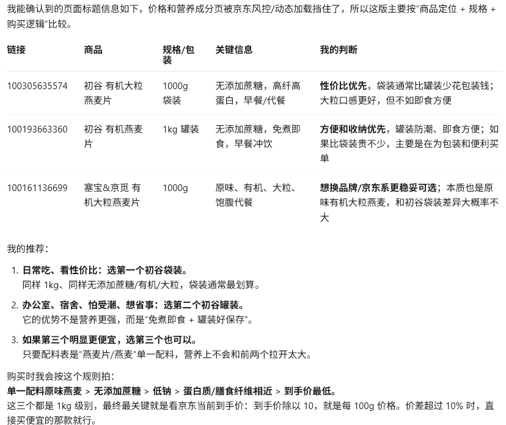
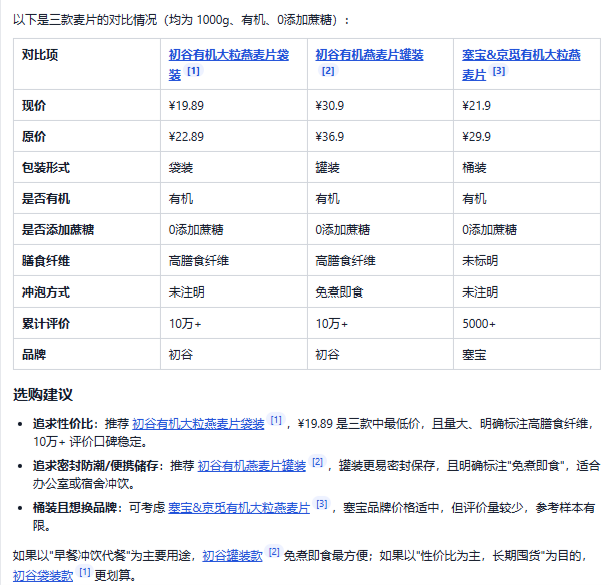
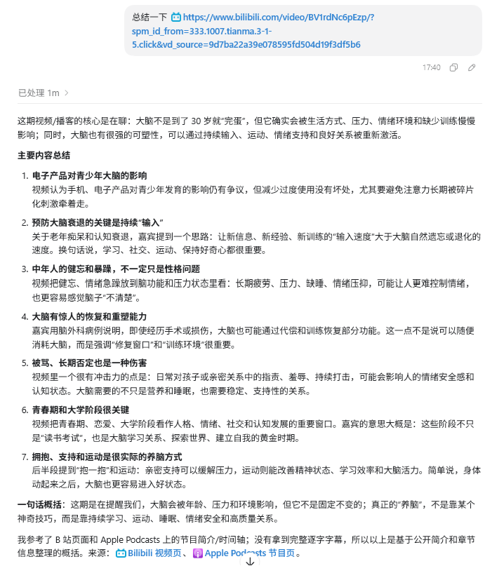
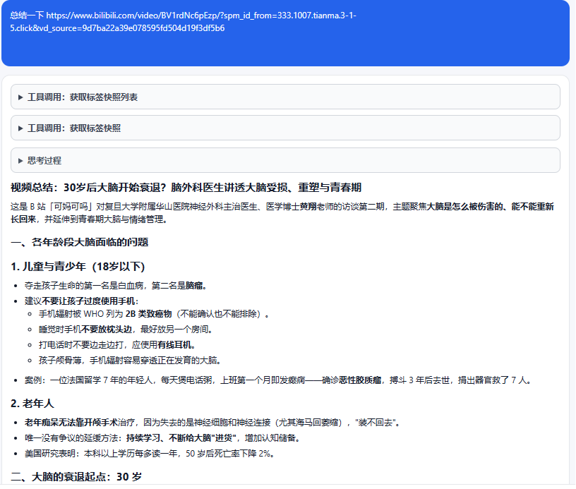

# clawtab 你的浏览器 AI 瑞士军刀
目前各大 智能体 工具都提供的联网搜索功能，有的还提供了 CDP 功能直接连接本机的 Chrome 浏览器来打开网页抓取 HTML 。但是真正使用起来却发现体验不尽如人意，首先是抓取效率低下，等待时间长；其次是智能体提取 HTML 内容的时候容易抓不住重点，导致总结的信息有缺失。

仔细分析一下，这也难怪，常用的智能体工具，内置的系统提示词是为了适配通用场景的，具体到提取某个特定网站 HTML 结构的场景很可能会顾此失彼。所以为了让自己在使用大模型时充分发挥其作用，我开发了 [ClawTab](https://clawtab.whyun.com/) 这个浏览器插件，让你在任意支持 Chrome 插件的浏览器上能够畅快的使用大模型总结网页、比价对比商品、甚至能直接使用搜索引擎。

## 1. 商品比价

下面是一组使用 codex 和 ClawTab 的对比示例，提示词如下：

```
对比这几个麦片：
https://item.jd.com/100305635574.html
https://item.jd.com/100193663360.html
https://item.jd.com/100161136699.html
```

codex 的回复比较中性：



**图 1.1 codex 读取京东商品**

购物网站输出的 HTML 结构比较复杂，过多的排版内容对于大模型来说都是噪音，还有一个比较致命的问题是它不能精确拿到售价，这对于购物类的网页抓取来说是大忌，使用体验大打折扣。

对比一下 ClawTab，由于直接解析 HTML 内容，所以能够精确的拿到售价内容，并贴心的给出了购买建议：



**图 1.2 ClawTab 读取京东商品**

## 2. 视频总结

ClawTab 支持 bilibili 和 youtube 视频的字幕提取功能，所以在视频总结的时候获得的信息更加丰富。下面是测试用的提示词：

```
总结一下 https://www.bilibili.com/video/BV1rdNc6pEzp/?spm_id_from=333.1007.tianma.3-1-5.click&vd_source=9d7ba22a39e078595fd504d19f3df5b6
```



**图 2.1 codex 总结 B 站视频**

codex 由于没有直接读取字幕，所以只能靠搜索来总结内容，内容写得细节不够丰富。



**图 2.2. ClawTab 读取 B 站视频**

ClawTab 借助是读取视频字幕，内容就丰富起来了，由于内容比较多，图片只截取了一部分。
